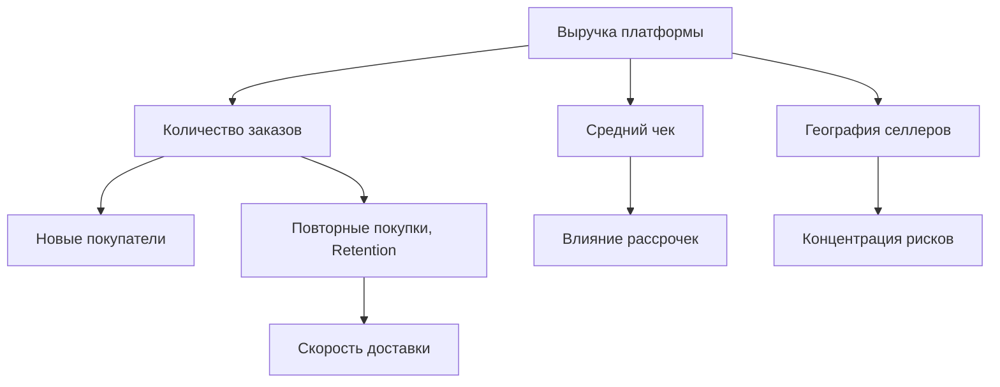

# 📊 Olist E-commerce: Unit Economics & Marketplace Growth Drivers

Аналитическое исследование юнит-экономики, платежных паттернов и географии селлеров на маркетплейсе Olist. Проект смоделирован под реальные бизнес-задачи двухсторонних e-com платформ: поиск точек роста AOV, факторов удержания и логистических рисков.

---

## 🎯 Бизнес-контекст и дерево метрик

Анализ построен на классической декомпозиции выручки (`Выручка = Количество заказов × Средний чек`) с углублением в драйверы каждого множителя, балансируя интересы селлеров (маржинальность, логистика) и покупателей (цена, скорость).



🛠 Стек технологий

База данных: PostgreSQL

Инструменты: SQL (CTE, Window Functions, NTILE), Apache Superset

Методология: Декомпозиция метрик, когортный анализ, Парето-сегментация

🔍 Ключевые инсайты и SQL-реализация

1. Платёжная аналитика: рассрочка vs без рассрочки
Гипотеза: наличие рассрочки стимулирует и рост AOV, и объём заказов.

````sql
WITH order_values AS (
    SELECT
        o.order_id,
        SUM(oi.price::DECIMAL) AS total_price
    FROM orders o
    JOIN order_items oi ON o.order_id = oi.order_id
    WHERE o.order_status = 'delivered'
    GROUP BY o.order_id
),
order_installments AS (
    SELECT
        op.order_id,
        MAX(CASE WHEN op.payment_installments > 1 THEN 1 ELSE 0 END) AS has_installments,
        MAX(op.payment_installments) AS max_installments
    FROM order_payments op
    GROUP BY op.order_id
),
order_level AS (
    SELECT
        ov.order_id,
        ov.total_price,
        oi.has_installments,
        oi.max_installments
    FROM order_values ov
    JOIN order_installments oi ON ov.order_id = oi.order_id
),
totals AS (
    SELECT SUM(total_price) AS market_revenue, COUNT(*) AS market_orders
    FROM order_level
)
SELECT
    CASE WHEN has_installments = 1 THEN 'С рассрочкой' ELSE 'Без рассрочки' END AS installment_group,
    COUNT(*) AS orders_count,
    ROUND(COUNT(*) * 100.0 / (SELECT market_orders FROM totals), 1) AS orders_share_pct,
    ROUND(SUM(total_price), 2) AS total_revenue,
    ROUND(SUM(total_price) * 100.0 / (SELECT market_revenue FROM totals), 1) AS revenue_share_pct,
    ROUND(AVG(total_price), 2) AS avg_aov,
    ROUND(AVG(max_installments), 1) AS avg_installments
FROM order_level
GROUP BY has_installments
ORDER BY has_installments DESC;
````

Результат:

| installment_group | orders_count | orders_share_pct | total_revenue | revenue_share_pct | avg_aov | avg_installments |
|---|---:|---:|---:|---:|---:|---:|
| **С рассрочкой** | 49 661 | 51.5% | 8 542 651.90 | 64.6% | 172.02 | 4.7 |
| **Без рассрочки** | 46 816 | 48.5% | 4 678 711.24 | 35.4% | 99.94 | 1.0 |
| **Итого** | 96 477 | 100% | 13 221 363.14 | 100% | — | — |

Инсайт: заказы с рассрочкой имеют AOV на [X]% выше и составляют [X]% выручки.


