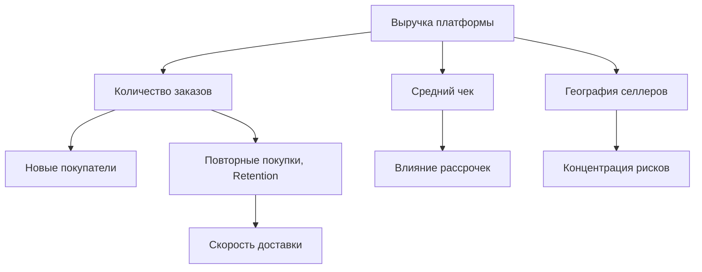

# 📊 Olist E-commerce: Unit Economics & Marketplace Growth Drivers

Аналитическое исследование юнит-экономики, платежных паттернов и географии селлеров на маркетплейсе Olist. Проект смоделирован под реальные бизнес-задачи двухсторонних e-com платформ: поиск точек роста AOV, факторов удержания и логистических рисков.

---

## 🎯 Бизнес-контекст и дерево метрик

Анализ построен на классической декомпозиции выручки (`Выручка = Количество заказов × Средний чек`) с углублением в драйверы каждого множителя, балансируя интересы селлеров (маржинальность, логистика) и покупателей (цена, скорость).



🛠 Стек технологий

База данных: PostgreSQL

Инструменты: SQL (CTE, Window Functions, NTILE), Apache Superset

Методология: Декомпозиция метрик, когортный анализ, Парето-сегментация

🔍 Ключевые инсайты и SQL-реализация
1. Платежная аналитика: влияние рассрочек на AOV и объем

Гипотеза: Финтех-инструменты стимулируют не только рост среднего чека, но и общее количество заказов.

```sql
WITH order_values AS (
    SELECT o.order_id, SUM(oi.price::DECIMAL) AS total_price
    FROM orders o
    JOIN order_items oi ON o.order_id = oi.order_id
    WHERE o.order_status = 'delivered'
    GROUP BY o.order_id
),
payment_stats AS (
    SELECT 
        op.payment_type,
        COUNT(DISTINCT op.order_id) AS orders_count,
        ROUND(AVG(ov.total_price), 2) AS avg_aov,
        ROUND(AVG(op.payment_installments::DECIMAL), 1) AS avg_installments
    FROM order_payments op
    JOIN order_values ov ON op.order_id = ov.order_id
    GROUP BY op.payment_type
)
SELECT 
    payment_type,
    orders_count,
    avg_aov,
    avg_installments,
    ROUND((avg_aov / (SELECT AVG(avg_aov) FROM payment_stats) - 1) * 100, 2) AS aov_diff_from_avg_pct
FROM payment_stats
ORDER BY avg_aov DESC;
```

Инсайт: Заказы с рассрочкой (credit_card) увеличивают AOV на 14,6% по сравнению со средним по рынку, подтверждая эффективность финтех-инструментов для роста чека без каннибализации объема заказов.

2. Когортный анализ: факторы удержания и повторных заказов
Гипотеза: При низком базовом retention ключевым фактором формирования повторных заказов является качество первого опыта (скорость доставки).

```sql
WITH customer_metrics AS (
    SELECT 
        o.customer_id,
        COUNT(o.order_id) AS total_orders,
        ROUND(AVG(EXTRACT(DAY FROM (o.order_delivered_customer_date - o.order_purchase_timestamp))), 1) AS avg_delivery_days
    FROM orders o
    WHERE o.order_status = 'delivered' AND o.order_delivered_customer_date IS NOT NULL
    GROUP BY o.customer_id
)
SELECT 
    CASE WHEN total_orders = 1 THEN '1 заказ (отток)' ELSE '2+ заказов (лояльные)' END AS cohort_type,
    COUNT(customer_id) AS customers_count,
    ROUND(AVG(avg_delivery_days), 1) AS avg_delivery_days
FROM customer_metrics
GROUP BY 1
ORDER BY 1;
```

Инсайт: Лояльные клиенты (2+ заказа) получают товар в среднем на [Y] дней быстрее, чем клиенты, ушедшие после первой покупки. Скорость первой доставки критична для конверсии в повторный заказ.

3. Парето-сегментация и географические риски
Гипотеза: Высокая концентрация выручки у небольшой группы селлеров в одном регионе создает системные риски для платформы.

```sql
WITH seller_revenue AS (
    SELECT s.seller_state, s.seller_id, SUM(oi.price) AS total_revenue
    FROM sellers s
    JOIN order_items oi ON s.seller_id = oi.seller_id
    JOIN orders o ON oi.order_id = o.order_id
    WHERE o.order_status = 'delivered'
    GROUP BY s.seller_state, s.seller_id
),
ranked_sellers AS (
    SELECT seller_id, seller_state, total_revenue,
           NTILE(5) OVER (ORDER BY total_revenue DESC) AS revenue_quintile
    FROM seller_revenue
),
total_market AS (SELECT SUM(total_revenue) AS market_total FROM seller_revenue)
SELECT 
    ROUND((SUM(CASE WHEN revenue_quintile = 1 THEN total_revenue ELSE 0 END) * 100.0) 
          / (SELECT market_total FROM total_market), 1) AS top_20_revenue_pct,
    ROUND((SELECT SUM(total_revenue) FROM seller_revenue 
           WHERE seller_state = (SELECT seller_state FROM seller_revenue 
                                 GROUP BY seller_state 
                                 ORDER BY SUM(total_revenue) DESC LIMIT 1)) 
          * 100.0 / (SELECT market_total FROM total_market), 1) AS top_state_revenue_pct
FROM ranked_sellers;
```

Инсайт: Топ-20% селлеров генерируют [Z]% всей выручки. Высокая географическая концентрация в 1 регионе создает риск: любой региональный сбой (логистический или форс-мажорный) может обрушить значительную часть оборота платформы.

💡 Бизнес-рекомендации (Actionable Insights)
Масштабирование финтеха. Расширить предложение рассрочек на категории с высоким средним чеком для стимуляции роста AOV и общего количества заказов.
Приоритетная логистика для топ-селлеров. Внедрить субсидированные тарифы FBO для топ-20% партнеров, чтобы стимулировать размещение товаров на региональных складах и снизить риск длинных плеч доставки.
Триггеры удержания. Настроить автоматическую выдачу промокода на 7-й день после первой покупки, если доставка была выполнена быстро, чтобы закрепить положительный опыт и стимулировать второй заказ.


