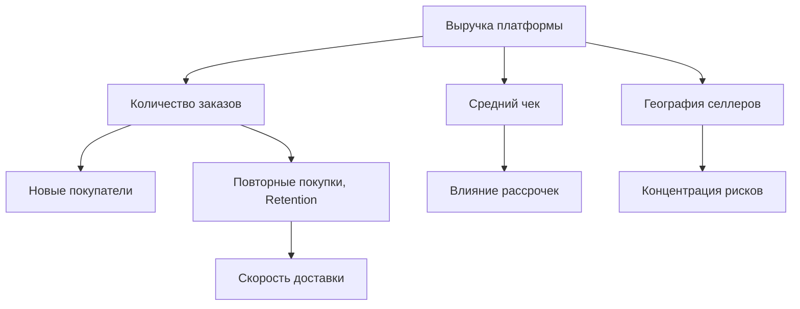

# 📊 Olist E-commerce: Unit Economics & Marketplace Growth Drivers

Аналитическое исследование юнит-экономики, платежных паттернов и географии селлеров на маркетплейсе Olist. Проект смоделирован под реальные бизнес-задачи двухсторонних e-com платформ: поиск точек роста AOV, факторов удержания и логистических рисков.

---

## 🎯 Бизнес-контекст и дерево метрик

Анализ построен на классической декомпозиции выручки (`Выручка = Количество заказов × Средний чек`) с углублением в драйверы каждого множителя, балансируя интересы селлеров (маржинальность, логистика) и покупателей (цена, скорость).



🛠 Стек технологий

База данных: PostgreSQL

Инструменты: SQL (CTE, Window Functions, NTILE), Apache Superset

Методология: Декомпозиция метрик, когортный анализ, Парето-сегментация

🔍 Ключевые инсайты и SQL-реализация

1. Платёжная аналитика: рассрочка vs без рассрочки
Гипотеза: наличие рассрочки стимулирует и рост AOV, и объём заказов.

````sql
WITH order_values AS (
    SELECT
        o.order_id,
        SUM(oi.price::DECIMAL) AS total_price
    FROM orders o
    JOIN order_items oi ON o.order_id = oi.order_id
    WHERE o.order_status = 'delivered'
    GROUP BY o.order_id
),
order_installments AS (
    SELECT
        op.order_id,
        MAX(CASE WHEN op.payment_installments > 1 THEN 1 ELSE 0 END) AS has_installments,
        MAX(op.payment_installments) AS max_installments
    FROM order_payments op
    GROUP BY op.order_id
),
order_level AS (
    SELECT
        ov.order_id,
        ov.total_price,
        oi.has_installments,
        oi.max_installments
    FROM order_values ov
    JOIN order_installments oi ON ov.order_id = oi.order_id
),
totals AS (
    SELECT SUM(total_price) AS market_revenue, COUNT(*) AS market_orders
    FROM order_level
)
SELECT
    CASE WHEN has_installments = 1 THEN 'С рассрочкой' ELSE 'Без рассрочки' END AS installment_group,
    COUNT(*) AS orders_count,
    ROUND(COUNT(*) * 100.0 / (SELECT market_orders FROM totals), 1) AS orders_share_pct,
    ROUND(SUM(total_price), 2) AS total_revenue,
    ROUND(SUM(total_price) * 100.0 / (SELECT market_revenue FROM totals), 1) AS revenue_share_pct,
    ROUND(AVG(total_price), 2) AS avg_aov,
    ROUND(AVG(max_installments), 1) AS avg_installments
FROM order_level
GROUP BY has_installments
ORDER BY has_installments DESC;
````

Результат:

| installment_group | orders_count | orders_share_pct | total_revenue | revenue_share_pct | avg_aov | avg_installments |
|---|---:|---:|---:|---:|---:|---:|
| **С рассрочкой** | 49 661 | 51.5% | 8 542 651.90 | 64.6% | 172.02 | 4.7 |
| **Без рассрочки** | 46 816 | 48.5% | 4 678 711.24 | 35.4% | 99.94 | 1.0 |
| **Итого** | 96 477 | 100% | 13 221 363.14 | 100% | — | — |

Инсайт: заказы с рассрочкой имеют AOV на 72% выше и составляют 65% выручки.


2. Когортный анализ: лояльные vs нелояльные
Гипотеза: качество первого опыта (скорость первой доставки) — ключевой фактор повторного заказа.
````sql
WITH order_totals AS (
    SELECT
        oi.order_id,
        SUM(oi.price::DECIMAL) AS order_total
    FROM order_items oi
    GROUP BY oi.order_id
),
customer_orders AS (
    SELECT
        c.customer_unique_id,
        o.order_id,
        ot.order_total,
        EXTRACT(DAY FROM (
            o.order_delivered_customer_date::timestamp
            - o.order_purchase_timestamp::timestamp
        )) AS delivery_days,
        o.order_purchase_timestamp::timestamp AS order_purchase_timestamp,
        ROW_NUMBER() OVER (
            PARTITION BY c.customer_unique_id
            ORDER BY o.order_purchase_timestamp::timestamp
        ) AS order_rank
    FROM orders o
    JOIN customers c ON o.customer_id = c.customer_id
    JOIN order_totals ot ON o.order_id = ot.order_id
    WHERE o.order_status = 'delivered'
      AND o.order_delivered_customer_date IS NOT NULL
      AND o.order_delivered_customer_date <> ''
      AND o.order_purchase_timestamp <> ''
),
customer_metrics AS (
    SELECT
        customer_unique_id,
        COUNT(DISTINCT order_id) AS total_orders,
        SUM(order_total) / COUNT(DISTINCT order_id) AS avg_aov,
        AVG(delivery_days) AS avg_delivery_days,
        MAX(CASE WHEN order_rank = 1 THEN delivery_days END) AS first_delivery_days
    FROM customer_orders
    GROUP BY customer_unique_id
)
SELECT
    CASE WHEN total_orders = 1 THEN 'Нелояльные (1 заказ)' ELSE 'Лояльные (2+ заказа)' END AS cohort,
    COUNT(*) AS customers_count,
    ROUND(COUNT(*) * 100.0 / SUM(COUNT(*)) OVER (), 1) AS customers_share_pct,
    ROUND(AVG(total_orders), 1) AS avg_orders_per_customer,
    ROUND(AVG(avg_aov), 2) AS avg_aov,
    ROUND(AVG(first_delivery_days), 1) AS avg_first_delivery_days,
    ROUND(
        PERCENTILE_CONT(0.5) WITHIN GROUP (ORDER BY first_delivery_days)::DECIMAL, 1
    ) AS median_first_delivery_days
FROM customer_metrics
WHERE first_delivery_days IS NOT NULL
GROUP BY (total_orders = 1)
ORDER BY (total_orders = 1);
````
Результат:

Инсайт: лояльные клиенты получают первую доставку в среднем на [Y] дней быстрее, медиана подтверждает направление. Это корреляция; для causal-вывода нужен контроль на регион и категорию.

3. Парето-сегментация селлеров
Гипотеза: выручка сконцентрирована у узкой группы селлеров, что создаёт системный риск.

````sql
WITH seller_revenue AS (
    SELECT
        s.seller_id,
        s.seller_state,
        SUM(oi.price::DECIMAL) AS total_revenue,
        COUNT(DISTINCT o.order_id) AS orders_count,
        AVG(
            EXTRACT(DAY FROM (
                o.order_delivered_customer_date::timestamp
                - o.order_purchase_timestamp::timestamp
            ))
        ) AS avg_delivery_days
    FROM sellers s
    JOIN order_items oi ON s.seller_id = oi.seller_id
    JOIN orders o ON oi.order_id = o.order_id
    WHERE o.order_status = 'delivered'
      AND o.order_delivered_customer_date IS NOT NULL
      AND o.order_delivered_customer_date <> ''
      AND o.order_purchase_timestamp <> ''
    GROUP BY s.seller_id, s.seller_state
),
ranked AS (
    SELECT
        seller_id,
        seller_state,
        total_revenue,
        orders_count,
        avg_delivery_days,
        NTILE(5) OVER (ORDER BY total_revenue DESC) AS revenue_quintile
    FROM seller_revenue
),
totals AS (
    SELECT
        SUM(total_revenue) AS market_total,
        COUNT(*) AS market_sellers
    FROM ranked
),
grouped AS (
    SELECT
        revenue_quintile,
        COUNT(*) AS sellers_count,
        SUM(total_revenue) AS group_revenue,
        AVG(avg_delivery_days) AS avg_delivery_days,
        SUM(CASE WHEN seller_state = 'SP' THEN 1 ELSE 0 END) AS sp_sellers
    FROM ranked
    GROUP BY revenue_quintile
)
SELECT
    CASE revenue_quintile
        WHEN 1 THEN 'Top 20% (0–20%)'
        WHEN 2 THEN 'Upper mid (20–40%)'
        WHEN 3 THEN 'Middle (40–60%)'
        WHEN 4 THEN 'Lower mid (60–80%)'
        WHEN 5 THEN 'Bottom 20% (80–100%)'
    END AS revenue_group,
    revenue_quintile,
    sellers_count,
    ROUND(sellers_count * 100.0 / (SELECT market_sellers FROM totals), 1) AS sellers_share_pct,
    ROUND(group_revenue, 2) AS group_revenue,
    ROUND(group_revenue * 100.0 / (SELECT market_total FROM totals), 1) AS revenue_share_pct,
    ROUND(
        SUM(group_revenue) OVER (ORDER BY revenue_quintile) * 100.0
        / (SELECT market_total FROM totals), 1
    ) AS cumulative_revenue_share_pct,
    ROUND(avg_delivery_days, 1) AS avg_delivery_days,
    ROUND(sp_sellers * 100.0 / sellers_count, 1) AS sp_sellers_share_pct
FROM grouped
ORDER BY revenue_quintile;
````

Результат:

Инсайт: топ-20% селлеров дают [Z]% выручки; их доля из SP — [Z]%, и они же быстрее по доставке. Концентрация в одном штате = системный логистический риск.

4. География селлеров
Гипотеза: продавцы сконцентрированы в одном штате, что усиливает логистический риск.

````sql
WITH seller_revenue AS (
    SELECT
        s.seller_id,
        s.seller_state,
        SUM(oi.price::DECIMAL) AS total_revenue,
        AVG(
            EXTRACT(DAY FROM (
                o.order_delivered_customer_date::timestamp
                - o.order_purchase_timestamp::timestamp
            ))
        ) AS avg_delivery_days
    FROM sellers s
    JOIN order_items oi ON s.seller_id = oi.seller_id
    JOIN orders o ON oi.order_id = o.order_id
    WHERE o.order_status = 'delivered'
      AND o.order_delivered_customer_date IS NOT NULL
      AND o.order_delivered_customer_date <> ''
      AND o.order_purchase_timestamp <> ''
    GROUP BY s.seller_id, s.seller_state
),
totals AS (
    SELECT
        SUM(total_revenue) AS market_total,
        COUNT(*) AS market_sellers
    FROM seller_revenue
)
SELECT
    seller_state,
    COUNT(*) AS sellers_count,
    ROUND(COUNT(*) * 100.0 / (SELECT market_sellers FROM totals), 1) AS sellers_share_pct,
    ROUND(SUM(total_revenue) * 100.0 / (SELECT market_total FROM totals), 1) AS revenue_share_pct,
    ROUND(AVG(avg_delivery_days), 1) AS avg_delivery_days
FROM seller_revenue
GROUP BY seller_state
ORDER BY sellers_count DESC;
````

Результат:

Инсайт: SP концентрирует [Z]% селлеров и [Z]% выручки; доставка из удалённых штатов (BA, CE) в среднем в 2–3 раза дольше, чем внутри SP. Это и есть «риск длинных плеч».

💡 Бизнес-рекомендации (Actionable Insights)
Масштабирование финтеха. Расширить рассрочку на high-AOV категории: заказы с рассрочкой дают AOV на [X]% выше и [X]% выручки.

Приоритетная логистика для топ-селлеров. Субсидировать FBO для топ-20% партнёров в регионах, чтобы снизить долю SP в выручке и риск «одного штата».

Триггеры удержания. Промокод на 7-й день после быстрой первой доставки: лояльные клиенты получают товар на [Y] дней быстрее, и это самый сильный прокси-retention фактор в данных.

Визуализации в Superset


